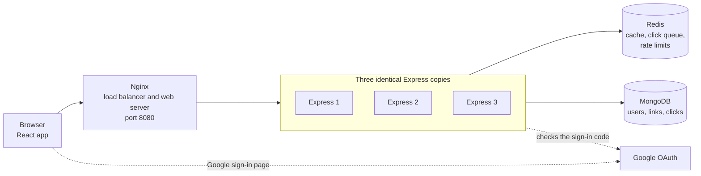

ZipLink
=======

A URL shortener built with the MERN stack. Create short links with password protection, expiration dates, QR codes and click analytics. Redis speeds up redirects, and Nginx spreads the traffic across three Express instances.

Features
--------

### Core Functionality

- **URL Shortening** - Turn long http and https addresses into short links
- **Custom Short URLs** - Choose your own code (optional)
- **QR Code Generation** - A QR code for every new link
- **Anonymous Links** - Create links without an account

### Security & Control

- **Password Protection** - Ask visitors for a password
- **Link Expiration** - Set an end date
- **Active Date Control** - Set a start date
- **Link Management** - Edit and delete your links
- **Rate Limiting** - Limit sign-ups, logins, link creation and password guesses

### User Authentication

- **Email/Password Authentication** - Sign up and log in with hashed passwords (Argon2)
- **Google OAuth** - Sign in with Google (optional)
- **JWT Authentication** - Session management with HTTP-only cookies
- **Protected Routes** - My links and analytics need a login

### Analytics Dashboard

- **Click Tracking** - Total clicks for each link
- **Device Breakdown** - Desktop, mobile and tablet clicks
- **Daily Trends** - Clicks per day for the last 30 days
- **Link Statistics** - Destination, status, dates and password setting

### Performance and Reliability

- **Redis Caching** - Redirects are answered from memory
- **Queued Click Counting** - Clicks are queued and saved to MongoDB in batches
- **Load Balancing** - Nginx shares requests between three Express instances
- **Graceful Fallback** - Links and logins keep working when Redis is down

Tech Stack
----------

### Frontend

- **React 19** - UI framework
- **Vite** - Build tool and dev server
- **TanStack Router** - Routing
- **TanStack Query** - Server state management
- **Redux Toolkit** - Login state management
- **Tailwind CSS** - Utility-first styling
- **Recharts** - Data visualization
- **Axios** - HTTP client
- **Lucide React** - Icon library

### Backend

- **Node.js 22** - Runtime environment
- **Express 5** - Web framework
- **MongoDB** - Database
- **Mongoose** - ODM for MongoDB
- **Redis** - Cache, click queue and rate limit counters
- **Passport.js** - Google sign-in
- **JWT** - Token-based authentication
- **Argon2** - Password hashing
- **NanoID** - Short code generation
- **QRCode** - QR code generation

### Infrastructure

- **Nginx** - Entry point, load balancer and web server for the React app
- **Docker Compose** - Runs all services together

Architecture
------------



### Components

- React App - The pages users see, served by Nginx
- Nginx - The public address on port 8080, serves the React app and shares requests between the Express instances
- Express (three instances) - Login, links, redirects and analytics, with no state kept in memory
- Redis - Link cache, click queue and rate limit counters
- MongoDB - Users, links and click records
- Google OAuth - Confirms who a person is for Google sign-in

### Opening a Short Link

1. The browser asks Nginx for the short code.
2. Nginx passes the request to the next Express instance.
3. Express reads the link from Redis, or from MongoDB on a miss (cached for 10 minutes).
4. Express queues the click in Redis and answers with a 302 redirect. Expired, not yet active and password protected links go to a page of the React app.
5. Every 5 seconds each instance saves the queued clicks to MongoDB in one batch.

### Creating a Link

1. Express checks the rate limit and validates the URL.
2. Express makes the short code, hashes the password if one is set, and saves the link in MongoDB.
3. Express returns the short URL and a QR code.

### Logging In

1. Express checks the password with Argon2.
2. Express sends a JWT in an HTTP-only cookie.
3. Any instance can verify the cookie on later requests.

### Google Sign-in

1. The browser opens `/api/auth/google` and Express redirects it to Google.
2. Google sends the browser back to the callback address with a one-time code.
3. Express checks a random state value, exchanges the code for the profile, and sets the login cookie.

Project Structure
-----------------

```
ZipLink/
├── Backend/                 Express API
│   ├── .env.example         Template for environment variables
│   ├── app.js               Express app entry point
│   ├── Dockerfile           Backend image
│   ├── package.json
│   └── src/
│       ├── config/          Configuration files
│       │   ├── config.js
│       │   ├── mongo.config.js
│       │   ├── passport.config.js
│       │   └── redis.config.js
│       ├── controller/      Request handlers
│       │   ├── analytics.controller.js
│       │   ├── auth.controller.js
│       │   ├── short_url.controller.js
│       │   └── user_url.controller.js
│       ├── dao/             Data Access Objects
│       │   ├── click.dao.js
│       │   ├── short_url.dao.js
│       │   └── user.dao.js
│       ├── middlewares/     Login check and rate limits
│       │   ├── auth.middleware.js
│       │   └── rateLimit.middleware.js
│       ├── models/          Database schemas
│       │   ├── click.model.js
│       │   ├── short_url.model.js
│       │   └── user.model.js
│       ├── routes/          API routes
│       │   ├── analytics.route.js
│       │   ├── auth.route.js
│       │   ├── protected.route.js
│       │   ├── short_url.route.js
│       │   └── user.route.js
│       ├── services/        Business logic
│       │   ├── analytics.service.js
│       │   ├── auth.service.js
│       │   ├── click.service.js
│       │   └── short_url.service.js
│       └── Utils/           Helper functions
│           ├── cache.js
│           ├── errorHandler.js
│           ├── generateQrCode.js
│           ├── getDeviceType.js
│           ├── helper.js
│           ├── jwtHelper.js
│           ├── validateDates.js
│           ├── validateSlug.js
│           └── validateUrl.js
├── Frontend/                React app
│   ├── .env.example         Template for environment variables
│   ├── index.html
│   ├── package.json
│   ├── vite.config.js
│   └── src/
│       ├── index.css        Global styles and theme
│       ├── main.jsx         App entry point
│       ├── RootLayout.jsx   Root layout component
│       ├── api/             API client functions
│       │   ├── ShortUrl.api.jsx
│       │   └── User.api.jsx
│       ├── components/      Reusable components
│       │   ├── CopyButton.jsx
│       │   ├── EditLinkModal.jsx
│       │   ├── GoogleAuthButton.jsx
│       │   ├── LoginForm.jsx
│       │   ├── NavBar.jsx
│       │   ├── RegisterForm.jsx
│       │   ├── RequireAuth.jsx
│       │   ├── StatusBadge.jsx
│       │   ├── UrlForm.jsx
│       │   ├── UserUrls.jsx
│       │   └── Analytics/   Analytics charts and cards
│       │       ├── DailyClicksChart.jsx
│       │       ├── DeviceBreakdownChart.jsx
│       │       ├── EmptyAnalytics.jsx
│       │       ├── LinkInfoCard.jsx
│       │       └── StatCard.jsx
│       ├── pages/           Page components
│       │   ├── AnalyticsPage.jsx
│       │   ├── AuthPage.jsx
│       │   ├── ExpiredLinkPage.jsx
│       │   ├── GoogleCallbackPage.jsx
│       │   ├── HomePage.jsx
│       │   ├── LinkNotActive.jsx
│       │   ├── NotFoundPage.jsx
│       │   ├── ProtectedLinkPage.jsx
│       │   └── UrlsPage.jsx
│       ├── routing/         Route definitions
│       │   └── index.jsx
│       ├── store/           Redux store
│       │   ├── store.js
│       │   └── slice/
│       │       └── authSlice.js
│       └── utils/           Utility functions
│           ├── axiosInstance.js
│           └── helper.js
├── nginx/                   Load balancer and web server
│   ├── Dockerfile           Builds the React app into the Nginx image
│   └── nginx.conf           Routing and load balancing rules
├── docker-compose.yml       Runs the whole system
├── DEPLOYMENT.md            Notes for running ZipLink for real
└── README.md
```

Installation and Setup
----------------------

### Prerequisites

- Docker Desktop - For Docker Compose (recommended)
- Node.js 22 and MongoDB - To run without Docker
- Redis - Optional
- Google OAuth credentials - Optional

### Run with Docker Compose

1. Create the environment file with `cp Backend/.env.example Backend/.env` and set `JWT_SECRET`.
2. Build and start the system with `docker compose up --build`.
3. Open http://localhost:8080

Docker Compose sets `MONGO_URI`, `REDIS_URL`, `APP_URL`, `FRONTEND_URL`, `GOOGLE_CALLBACK_URL` and `TRUST_PROXY` itself. Only the secrets come from `Backend/.env`.

### Backend Setup

1. Go to the backend directory with `cd Backend`.
2. Install dependencies with `npm install`.
3. Create the environment file with `cp .env.example .env` and set `JWT_SECRET`.
4. Start the development server with `npm run dev`.

The backend runs at http://localhost:5000.

### Frontend Setup

1. Go to the frontend directory with `cd Frontend`.
2. Install dependencies with `npm install`.
3. Start the development server with `npm run dev`.

The frontend runs at http://localhost:5173. It must use this port, because the backend only accepts requests from it.

### Google OAuth Setup

1. Create an OAuth client of type Web application in Google Cloud Console.
2. Add the callback address under Authorized redirect URIs, not under Authorized JavaScript origins. Use `http://localhost:8080/api/auth/google/callback` for Docker Compose and `http://localhost:5000/api/auth/google/callback` without Docker.
3. Add the credentials to `Backend/.env`:
   - `GOOGLE_CLIENT_ID=your_google_client_id`
   - `GOOGLE_CLIENT_SECRET=your_google_client_secret`
   - `GOOGLE_CALLBACK_URL=http://localhost:8080/api/auth/google/callback`

4. Restart the backend with `docker compose up -d --build`.

Keep the credentials in `Backend/.env` only. Never commit them.

Environment Variables
---------------------

The backend reads `Backend/.env`. Create it from the example file with `cp Backend/.env.example Backend/.env`, then fill in the empty values. `JWT_SECRET` is required.

### Server Configuration

- `PORT=5000`
- `NODE_ENV=development`

### Database

- `MONGO_URI=mongodb://localhost:27017/ziplink`

### Public Addresses

- `APP_URL=http://localhost:5000`
- `FRONTEND_URL=http://localhost:5173`

### JWT Secret

- `JWT_SECRET=` (required)

Generate one with `node -e "console.log(require('crypto').randomBytes(48).toString('hex'))"`.

### Redis

- `REDIS_URL=` (optional, leave empty to run without it)

### Proxy

- `TRUST_PROXY=0` (use 1 behind Nginx, otherwise 0)

### Google Credentials

Optional. All three values are needed together.

- `GOOGLE_CLIENT_ID=`
- `GOOGLE_CLIENT_SECRET=`
- `GOOGLE_CALLBACK_URL=http://localhost:5000/api/auth/google/callback`

### Frontend Settings

The frontend reads one optional variable from `Frontend/.env`. Never put a secret in a `VITE_` variable.

- `VITE_API_URL=http://localhost:5000`

Docker Compose Commands
-----------------------

### Start and Stop

- `docker compose up --build` - Build and start, showing logs
- `docker compose up -d --build` - Build and start in the background
- `docker compose stop` - Stop, keeping all data
- `docker compose start` - Start again
- `docker compose down` - Remove containers, keeping data
- `docker compose down -v` - Remove containers and delete all data
- `docker compose up -d --build nginx` - Rebuild only React and Nginx
- `docker compose up -d --build app1 app2 app3` - Rebuild only the backend instances

### Inspect

- `docker compose ps` - See what is running
- `docker compose logs -f` - Follow all logs
- `docker compose logs -f app1` - Follow one service
- `docker compose exec redis redis-cli llen clicks:queue` - Count clicks waiting in the queue
- `docker compose exec redis redis-cli keys "link:*"` - List cached links
- `docker compose exec mongo mongosh ziplink --eval "db.shorturls.countDocuments()"` - Count links in MongoDB
- `docker compose exec mongo mongosh ziplink --eval "db.clicks.countDocuments()"` - Count click records in MongoDB
- `curl -sI http://localhost:8080/api/auth/check` - See which instance answers (look at the X-Upstream line)

On Windows PowerShell, use `curl.exe` instead of `curl`.

API Endpoints
-------------

### Authentication

- `POST /api/auth/register` - Create an account
- `POST /api/auth/login` - Log in
- `POST /api/auth/logout` - Log out
- `GET /api/auth/check` - Who is logged in (login needed)
- `GET /api/auth/google` - Start Google sign-in
- `GET /api/auth/google/callback` - Google sends the browser back here

### URL Management

- `POST /api/create` - Create a short link, returns the short URL and a QR code
- `GET /api/user/urls?page=1&limit=10` - List your links (login needed)
- `PUT /api/user/urls/:id` - Change destination or dates (login needed)
- `DELETE /api/user/urls/:id` - Delete a link (login needed)
- `POST /api/protected/:code/unlock` - Send a password, get the destination
- `GET /:code` - The short link itself, redirects

### Analytics

- `GET /api/analytics/:code` - Clicks, daily chart data and devices (login needed)

### Rate Limits

- Register and login share 10 requests per 15 minutes
- Link creation allows 30 requests per minute
- Password attempts allow 10 requests per 15 minutes for each link

Limits are counted per visitor address. When one is hit, the answer is status 429 with a `Retry-After` header.

### Reserved Short Codes

These cannot be used as custom codes: `api`, `login`, `register`, `urls`, `analytics`, `auth`, `expired`, `not-active`, `protected` and `assets`.

Usage
-----

### Creating a Short URL

1. Open the home page. No account is needed.
2. Paste your URL, including `http://` or `https://`.
3. Optional: open More options to set a code, a password, a start date or an end date.
4. Press Shorten URL, then copy the link or download the QR code.

### Viewing Analytics

1. Log in and open My links.
2. Press Analytics on a link.

### Password-Protected Links

1. Set a password under More options.
2. Visitors enter it on the password page before they reach the destination.

### Link Expiration and Start Dates

1. Set Expires at, Active from, or both under More options.
2. Change them later with Edit in My links.

Testing Checklist
-----------------

Start the system with Docker Compose and open http://localhost:8080.

### Registration and Email Login

- Register with a name, an email and a password of 8 or more characters
- Register the same email again and expect "This email is already registered."
- Log in with a wrong password and expect "Invalid email or password."
- Open `/urls` while logged out and expect the login page

### Google Sign-in

This needs your own Google credentials.

- Press Continue with Google and expect to land on My links
- Sign in again and expect the same account
- Use an email that already has a password account and expect an error on the login page

### Link Creation and Redirects

- Create a link and expect a short URL and a QR code
- Open the short link and expect the destination
- Reuse a custom code and expect "already taken". Try `login` and expect "reserved"
- Open a password link in a private window. A wrong password shows an error, the right one redirects
- Open an expired link and a not yet active link and expect their pages
- Edit a destination and expect the redirect to change right away
- Delete a link and expect "URL not found"

### Analytics

- Open a link a few times, wait 10 seconds, and check its Analytics page
- Open Analytics for a link with no visits and expect the empty message

### Rate Limiting

Send 11 wrong login attempts in a row:

```
for i in $(seq 11); do
  curl -s -o /dev/null -w "%{http_code} " \
    -X POST http://localhost:8080/api/auth/login \
    -H "Content-Type: application/json" \
    -d '{"email":"nobody@example.com","password":"wrongwrong"}'
done
```

- Expect ten 401 answers, then 429
- Reset the counters with `docker compose exec redis redis-cli flushall`, which also clears the cache and the click queue

### System Behaviour

- Repeat `curl -sI http://localhost:8080/api/auth/check` and expect `X-Upstream` to change between three addresses
- Run `docker compose stop app2` and expect the site to keep working
- Run `docker compose stop redis` and expect redirects and logins to keep working

What Has Been Tested
--------------------

There is no automated test suite. Everything was checked by hand with scripts and a real browser.

### Tested End to End

- Registration, email login and logout
- Link creation with custom codes, passwords, dates and QR codes
- Redirects, including expired, not yet active and password protected links
- My links: list, edit, delete and pagination
- The analytics page
- The Redis cache, click queue, rate limits and the fallback when Redis is stopped
- Docker Compose with Nginx: load spread, one instance stopped, clean shutdown
- The full browser flow on ports 5173 and 8080 in Microsoft Edge

### Not Tested End to End

- Signing in with a real Google account. Only the redirect to Google and the callback code were checked, and the port 8080 callback is not registered with Google
- HTTPS and production settings
- Scanning a QR code with a phone
- Browsers other than Edge, and Docker on Linux or macOS
- Heavy traffic

Known Limitations
-----------------

### Analytics and Click Counting

- Analytics can be about 5 seconds behind, because clicks are saved every 5 seconds
- A crash can lose up to 500 clicks that were taken from the queue but not yet written to MongoDB
- A batch can be counted twice if its second MongoDB write fails after the first one succeeded
- `docker compose stop` saves queued clicks first, killing the containers does not
- When Redis is down, clicks are written to MongoDB directly
- Days are UTC, and clicks from before analytics existed appear only in the total
- No location data is recorded

### Single Points of Failure

- Redis: without it there is no cache, no rate limiting and no click queue
- Nginx: without it the site is unreachable
- MongoDB: without it most things stop

### Other

- Rate limits stop while Redis is down
- Logging out does not cancel a token, which stays valid for 7 days
- Google sign-in is refused for an email that already has a password account
- Emails are not verified and there is no password reset
- A link's password can only be set when the link is created
- A short code that does not exist shows a plain error, not a styled page
- `npm audit` reports 3 high severity advisories from `nodemon`, which is listed under `dependencies`. They are not fixed

Security Features
-----------------

- Argon2 hashing for passwords and link passwords
- HTTP-only, SameSite Lax login cookie
- The same error for a wrong password and an unknown email
- Rate limits on sign-up, login, link creation and password guesses
- Only http and https destinations are accepted
- A random state value checked on the Google callback
- Ownership checks on editing, deleting and analytics
- The Google client secret stays in `Backend/.env` and the backend containers
- Real `.env` files are ignored by Git, only the `.env.example` templates are tracked

Deployment
----------

See DEPLOYMENT.md for what to change before running ZipLink for other people.

Contributing
------------

1. Fork the project.
2. Create a feature branch.
3. Commit your changes.
4. Push the branch.
5. Open a pull request.

License
-------

No license has been chosen yet.

---

Made with ❤️ using React and Node.js
