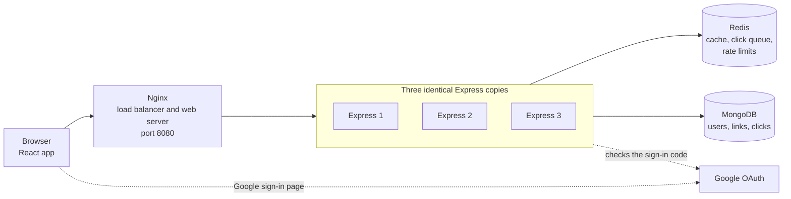

# ZipLink

ZipLink is a URL shortener. You paste a long address and get a short one that redirects to it. You can protect a link with a password, choose when it opens and closes, get a QR code, and see how many people clicked and on what kind of device.

It is built with React, Express and MongoDB. Redis makes redirects fast, and Nginx spreads the traffic over three copies of the backend. Everything starts with one Docker Compose command.

## Features

- Shorten any http or https address, with a random code or your own (3 to 30 letters, numbers, dash or underscore)
- QR code for every new link
- Optional password on a link
- Optional start date and end date. Before the start and after the end, visitors see a friendly page instead of the destination
- Sign up with email and password, or with Google
- A list of your links, where you can edit the destination and dates, or delete a link
- Analytics per link: total clicks, clicks per day for the last 30 days, and clicks by device (desktop, mobile, tablet)
- Rate limits on login, sign-up, link creation and password attempts

You can create links without an account. They just cannot be edited or analysed later.

## Technology

| Part | What is used |
| --- | --- |
| Frontend | React 19, Vite, Tailwind CSS, TanStack Router and Query, Redux Toolkit, Recharts, Axios |
| Backend | Node.js 22, Express 5, Mongoose |
| Database | MongoDB 7 |
| Cache and queue | Redis 7 |
| Login | Argon2 password hashing, JWT in an HTTP-only cookie, Passport for Google |
| Entry point | Nginx |
| Packaging | Docker and Docker Compose |

## How it works



### What each part does

| Part | Responsibility |
| --- | --- |
| React app | The pages you see. It is built once and served by Nginx. |
| Nginx | The single public address. It serves the React files and sends API calls and short links to the Express copies in turn (round robin). If a copy fails, it tries the next one. |
| Express copies | All the logic: login, creating links, redirects, analytics. They keep nothing in memory, so any copy can answer any request. |
| Redis | Remembers links so redirects skip the database, holds a queue of clicks waiting to be saved, and counts requests for the rate limits. |
| MongoDB | The permanent store for users, links and click records. |
| Google | Confirms who a person is when they use Google sign-in. |

### Opening a short link

1. The browser asks Nginx for `/aB3xK9q`.
2. Nginx passes the request to the next Express copy.
3. Express looks the code up in Redis. If it is not there, it reads MongoDB and stores the answer in Redis for 10 minutes.
4. Express checks the link dates and password setting. If the link is fine, it adds a click event to a Redis queue and answers with a redirect to the destination. If the link has expired, has not started yet, or needs a password, it sends the browser to a page of the React app.
5. Every 5 seconds, each Express copy takes waiting click events from the queue and saves them to MongoDB in one batch.

The redirect uses status 302, not 301. Browsers remember a 301 forever and would stop asking the server, so clicks could no longer be counted.

### Creating a link

The browser sends the address to Nginx, which passes it to Express. Express checks the rate limit, checks that the address is a valid http or https URL, makes a short code (or checks your custom one), hashes the password if there is one, and saves the link in MongoDB. MongoDB's unique index decides if a code is taken. If a random code collides, Express tries another one.

### Logging in

Express checks the password with Argon2 and signs a token (JWT). The token is stored in an HTTP-only cookie, so page scripts cannot read it. Every later request carries the cookie, and any Express copy can verify it. That is why the copies can be swapped freely.

### Google sign-in

1. The browser opens `/api/auth/google`. Express creates a random value, saves it in a short-lived cookie, and redirects the browser to Google.
2. The person signs in on Google's own page. The app never sees their Google password.
3. Google sends the browser back to the callback address with a one-time code.
4. Express checks that the random value matches the cookie, then trades the code for the person's profile by talking to Google directly with the client secret.
5. Express finds or creates the user, sets the same login cookie as a normal login, and sends the browser to the React app.

If an email is already registered with a password, Google sign-in for that email is refused. Sign-up does not verify email addresses, so linking the two would let someone take over an account.

## Project structure

```
ZipLink/
  Backend/               Express API
    src/routes           URL paths
    src/controller       Reads the request, sends the response
    src/services         The rules (validation, links, auth, clicks, analytics)
    src/dao              The only code that talks to MongoDB
    src/models           MongoDB schemas
    src/middlewares      Login check and rate limits
    src/config           Settings, MongoDB, Redis, Google
  Frontend/              React app
  nginx/                 Nginx settings and the image that builds the React app
  docker-compose.yml     The whole system
  DEPLOYMENT.md          Notes for running it for real
```

## Run it with Docker Compose

This is the recommended way. It starts everything.

You need Docker Desktop (or Docker Engine with the Compose plugin).

1. Create the backend settings file.

   ```
   cp Backend/.env.example Backend/.env
   ```

2. Open `Backend/.env` and fill in `JWT_SECRET`. Generate a value with:

   ```
   node -e "console.log(require('crypto').randomBytes(48).toString('hex'))"
   ```

   Leave the Google values empty for now. Everything except Google sign-in works without them.

3. Start the system.

   ```
   docker compose up --build
   ```

4. Open http://localhost:8080

The first build downloads images and takes a few minutes.

Docker Compose sets its own values for `MONGO_URI`, `REDIS_URL`, `APP_URL`, `FRONTEND_URL`, `GOOGLE_CALLBACK_URL` and `TRUST_PROXY`, and these replace the ones in `Backend/.env`. Only the secrets are read from that file.

The address you use is always http://localhost:8080. Short links look like `http://localhost:8080/aB3xK9q`.

## Run it without Docker

Use this if you want to work on the code. You need Node.js 22 and a MongoDB server running on your machine. Redis is optional. Without it, the app works but has no cache and no rate limits.

Backend:

```
cd Backend
cp .env.example .env        # then fill in JWT_SECRET
npm install
npm run dev
```

Frontend, in a second terminal:

```
cd Frontend
npm install
npm run dev
```

Open http://localhost:5173. The backend runs at http://localhost:5000.

The frontend must run on port 5173, because the backend only accepts requests from that address.

## Environment variables

Backend, in `Backend/.env`:

| Name | Needed | Meaning |
| --- | --- | --- |
| `JWT_SECRET` | Yes | Long random text that signs login tokens. The app does not start without it. |
| `MONGO_URI` | Yes | MongoDB address. |
| `APP_URL` | Yes | Address that short links start with. |
| `FRONTEND_URL` | No | Address of the React app. Default `http://localhost:5173`. |
| `PORT` | No | Backend port. Default `5000`. |
| `REDIS_URL` | No | Redis address. Empty means no cache and no rate limits. |
| `TRUST_PROXY` | No | Number of proxies in front of the backend. Use `1` behind Nginx, otherwise `0`. |
| `NODE_ENV` | No | `production` makes cookies Secure, which needs HTTPS. |
| `GOOGLE_CLIENT_ID` | No | From Google Cloud Console. |
| `GOOGLE_CLIENT_SECRET` | No | From Google Cloud Console. Keep it private. |
| `GOOGLE_CALLBACK_URL` | No | Must match a redirect address registered in Google Cloud Console. |

Google sign-in turns on only when all three Google values are set. Variable names are case sensitive on Linux, so write `APP_URL` exactly.

Frontend, in `Frontend/.env` (optional):

| Name | Meaning |
| --- | --- |
| `VITE_API_URL` | Address of the backend. Default `http://localhost:5000`. |

Never put a secret in a `VITE_` variable. Everything with that prefix is visible to anyone who opens the site.

## Google sign-in setup

Google sign-in is optional. To turn it on:

1. Go to https://console.cloud.google.com and create a project (or pick one).
2. Open the OAuth consent screen section and set it up. While the app is in testing mode, add your own Google account as a test user.
3. Open the Credentials section and create an OAuth client ID of type Web application.
4. Under authorized redirect URIs, add the callback address for how you run the app:

   | How you run it | Callback address |
   | --- | --- |
   | Docker Compose | `http://localhost:8080/api/auth/google/callback` |
   | Without Docker | `http://localhost:5000/api/auth/google/callback` |

   The address must match exactly, including the port and no trailing slash. You can add both.
5. Copy the client ID and client secret into `Backend/.env`:

   ```
   GOOGLE_CLIENT_ID=...
   GOOGLE_CLIENT_SECRET=...
   GOOGLE_CALLBACK_URL=http://localhost:8080/api/auth/google/callback
   ```

   Use the callback address that matches how you run the app. With Docker Compose, the compose file already sets `GOOGLE_CALLBACK_URL` to the 8080 address.
6. Restart the backend (`docker compose up -d --build`, or restart `npm run dev`).

Keeping the credentials safe:

- Put them only in `Backend/.env`. That file is ignored by Git.
- Never put them in the Frontend folder, in a `VITE_` variable, in a commit, or in a chat message.
- If a secret ever leaks, open the credential in Google Cloud Console and create a new secret.
- Check what Git will commit with `git status` before you commit.

## Docker Compose commands

Run these from the project folder.

| Goal | Command |
| --- | --- |
| Build and start, showing logs | `docker compose up --build` |
| Build and start in the background | `docker compose up -d --build` |
| Stop, keeping all data | `docker compose stop` |
| Start again after a stop | `docker compose start` |
| Remove containers, keeping data | `docker compose down` |
| Remove containers and delete all data | `docker compose down -v` |
| Rebuild only the web part (React and Nginx) | `docker compose up -d --build nginx` |
| Rebuild only the backend copies | `docker compose up -d --build app1 app2 app3` |

Looking inside:

| Goal | Command |
| --- | --- |
| See what is running | `docker compose ps` |
| Follow all logs | `docker compose logs -f` |
| Follow one service | `docker compose logs -f app1` |
| Count clicks waiting in the queue | `docker compose exec redis redis-cli llen clicks:queue` |
| List cached links | `docker compose exec redis redis-cli keys "link:*"` |
| Count links in MongoDB | `docker compose exec mongo mongosh ziplink --eval "db.shorturls.countDocuments()"` |
| Count saved click records | `docker compose exec mongo mongosh ziplink --eval "db.clicks.countDocuments()"` |
| See which copy answers | `curl -sI http://localhost:8080/api/auth/check` (look at the `X-Upstream` line) |

On Windows PowerShell, `curl` is a different command. Use `curl.exe`, or run the examples in Git Bash.

## API overview

| Method and path | What it does | Login needed |
| --- | --- | --- |
| `POST /api/auth/register` | Create an account | No |
| `POST /api/auth/login` | Log in | No |
| `POST /api/auth/logout` | Log out | No |
| `GET /api/auth/check` | Who am I | Yes |
| `GET /api/auth/google` | Start Google sign-in | No |
| `GET /api/auth/google/callback` | Google sends the browser back here | No |
| `POST /api/create` | Create a short link. Returns the short URL and a QR code | No |
| `GET /api/user/urls?page=1&limit=10` | List your links | Yes |
| `PUT /api/user/urls/:id` | Change destination or dates | Yes |
| `DELETE /api/user/urls/:id` | Delete a link | Yes |
| `GET /api/analytics/:code` | Analytics for one of your links | Yes |
| `POST /api/protected/:code/unlock` | Send a password, get the destination | No |
| `GET /:code` | The short link itself, redirects | No |

Rate limits, counted per visitor address: register and login share 10 requests per 15 minutes, link creation is 30 per minute, and password attempts are 10 per 15 minutes for each link. When a limit is hit the answer is status 429 with a `Retry-After` header.

A few short codes are reserved because they are pages of the app: `api`, `login`, `register`, `urls`, `analytics`, `auth`, `expired`, `not-active`, `protected` and `assets`.

## Testing checklist

Start the system with Docker Compose and open http://localhost:8080. Tick each item as you go.

Registration and email login

- [ ] Open Log in, then Create an account. Register with a name, an email and a password of 8 or more characters. You land on My links, which is empty.
- [ ] Register the same email again (in a private window). You see "This email is already registered."
- [ ] Log out. Log in with the same email and password. You land on My links.
- [ ] Log in with a wrong password. You see "Invalid email or password."
- [ ] While logged out, open http://localhost:8080/urls. You are sent to the login page.

Google sign-in (needs your own Google credentials, see the setup section)

- [ ] Click Continue with Google and sign in. You land on My links with your Google name in the top bar.
- [ ] Log out and sign in with Google again. You get the same account, not a second one.
- [ ] Try Google sign-in with an email that already has a password account. You return to the login page with an explanation.

Creating links

- [ ] On the home page, paste `https://example.com/test` and press Shorten URL. You get a short link and a QR code.
- [ ] Scan the QR code with a phone, or open the short link. It goes to the destination.
- [ ] Open More options and create a link with a custom code, such as `my-test`. Try the same code again. You see "already taken."
- [ ] Try the custom code `login`. You see that it is reserved.
- [ ] Create a link with a password. Open it in a private window. You see the password page. A wrong password shows an error, the right one opens the destination.
- [ ] Create a link that expires in a few minutes. After it expires, opening it shows the "link has expired" page.
- [ ] Create a link that starts in the future. Opening it shows the "not active yet" page.

Redirects, editing and deleting

- [ ] In My links, edit a link's destination, open the short link again, and confirm the new destination is used right away.
- [ ] Delete a link and open its short address. You see "URL not found".

Analytics

- [ ] Open a link several times, from a phone and from a computer if you can.
- [ ] Wait about 10 seconds, then open Analytics for that link. Total clicks, the daily chart and the device bars show the visits.
- [ ] Open Analytics for a link with no visits. You see the "no clicks recorded yet" message.

Rate limiting

- [ ] Run this in a terminal. The first ten answers are 401 and the eleventh is 429.

  ```
  for i in $(seq 11); do curl -s -o /dev/null -w "%{http_code} " -X POST http://localhost:8080/api/auth/login -H "Content-Type: application/json" -d '{"email":"nobody@example.com","password":"wrongwrong"}'; done
  ```

- [ ] To reset the counters, wait 15 minutes, or run `docker compose exec redis redis-cli flushall`. That also clears the cache and any clicks still in the queue.

System behaviour

- [ ] Run `curl -sI http://localhost:8080/api/auth/check` several times. The `X-Upstream` address changes between three values.
- [ ] Run `docker compose stop app2`. The site keeps working. Start it again with `docker compose start app2`.
- [ ] Run `docker compose stop redis`. Redirects and logins still work. Start it again with `docker compose start redis`.

## What has been tested, and what has not

There is no automated test suite. Everything below was checked by hand with scripts and a real browser while the project was built.

Tested end to end:

- Email registration, login, logout and the logged-in check
- Link creation with custom codes, passwords, start and end dates, and QR codes
- Redirects, including expired, not yet active and password protected links, and the password page
- My links: list, edit, delete, pagination
- Analytics page, with seeded and real clicks, in light and dark themes and at phone width
- Redis cache, cache removal on edit and delete, the click queue, the rate limits, and the fall back to MongoDB when Redis is stopped
- Docker Compose with Nginx: even spread over three copies, a copy stopped while the site kept working, and a clean shutdown that saves queued clicks
- The full browser flow through both http://localhost:5173 (without Docker) and http://localhost:8080 (Docker Compose), using Microsoft Edge

Not tested end to end:

- Signing in with a real Google account. What was checked: Express redirects to Google with the right client and callback address, Google accepted the request and showed its sign-in page (checked for the callback on port 5000), and the code that handles the return was run with a stand-in for Google. The callback on port 8080 has not been registered with Google or tried.
- HTTPS and production settings, including Secure cookies
- Scanning a QR code with a phone. The image was generated and looked correct.
- Any browser other than Edge, and Docker on Linux or macOS
- Heavy traffic or many users at once
- Device detection for unusual devices. It reads the browser's user agent text and is approximate.

## Known limitations

Analytics and click counting

- Click counts are not instant. A click waits in Redis and is saved by a job that runs every 5 seconds, so analytics can be about 5 seconds behind.
- A crash can lose clicks. A copy takes up to 500 clicks out of the Redis queue and then writes them to MongoDB. If that copy crashes in between, those clicks, up to 500, are lost. If MongoDB reports an error, the batch is put back in the queue instead.
- A batch can be counted twice. A batch needs two MongoDB writes, the click records and the link's counter. If the second write fails after the first one worked, the batch is retried and the first part is saved again. This should be rare.
- Stopping the system cleanly (`docker compose stop`) saves queued clicks first. Killing it does not.
- When Redis is down, clicks are written to MongoDB directly instead of through the queue. They show up in analytics straight away. The visitor does not wait for that write.
- Days in the daily chart are UTC days. Clicks from before analytics existed are in the total but not in the daily or device charts.

Single points of failure

- There is one Redis. If it stops, links still redirect and logins still work, but there is no cache, no rate limiting and no queue until it returns.
- There is one Nginx. If it stops, the site is unreachable even though the backend copies are healthy.
- There is one MongoDB. If it stops, most things stop.
- To remove these in a real deployment you would run Redis replicas with Sentinel or Cluster, more than one Nginx behind a cloud load balancer, and a MongoDB replica set.

Other

- Rate limits stop working while Redis is down. They fail open, so nobody is locked out, but login attempts are not limited during an outage.
- Logging out removes the cookie but cannot cancel the token on the server. A copied token stays valid for 7 days.
- Email addresses are not verified, and there is no password reset.
- A link's password can be set only when the link is created.
- A visitor who opens a short code that does not exist sees a plain error message, not a styled page.
- Backend dependencies: `npm audit` reports 3 high severity advisories. All three come from `nodemon`, a development tool that is listed under `dependencies` instead of `devDependencies` in `Backend/package.json`. They have not been fixed. See DEPLOYMENT.md.

## Security notes

- Passwords are hashed with Argon2. Link passwords too.
- The login cookie is HTTP-only and SameSite Lax.
- Login answers are the same for a wrong password and an unknown email.
- The Google client secret exists only in `Backend/.env` and in the backend containers' environment. It is not in any image, in the frontend, or in Git.
- Real `.env` files are ignored by Git at the project root and in both folders. Only the `.env.example` templates are tracked.

## More

DEPLOYMENT.md has notes for running ZipLink outside your own computer.
